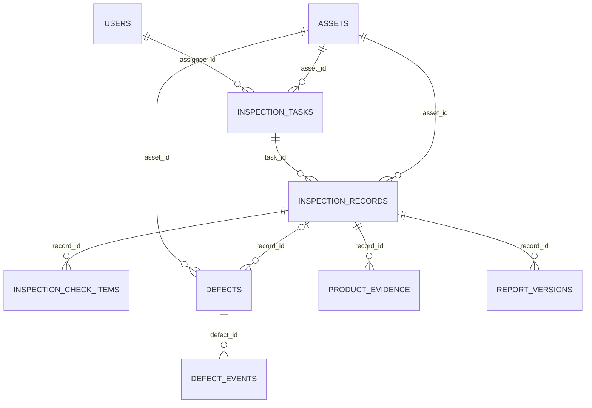

# 巡检业务流程与数据关系

## 从工程总览执行巡检

打开工程后，点击「工程总览 → 打开巡检工作台」。先登记或选中台账设备、填写测点，再选已派发的任务并打开巡检草稿。采集资料可直接归入该草稿。未选任务时，资料保存到当前工程和测点。

- 「采集」可连接相机拍照或录像、录制六麦或其他可用音频源、保存热像和对应的温度矩阵。其他时序数据可用首列为 `time_s` 或 `time_ms` 的 CSV 导入。导入时可填写带时区的 ISO 8601 首个样本时间。
- 「时间融合」按设备、测点和巡检记录分组。在用户所选模态中，算法为每种模态选取与参考证据时间区间最接近的一份资料。工作台显示 UTC 时间、来源、毫秒偏移、与参考区间的间隙，以及所有选中模态是否有共同时间点。相机使用帧时间，热像使用主机接收时间，音频起点由首块接收时间估算。文件修改时间只用于估算证据时刻。
- 「大模型分析」将已选证据、时间对齐信息、可提取指标及巡检读数送往板端推理服务，保存带证据引用的复测建议。「巡检记录」用于填写检查项、过程说明和登记检查项缺陷，提交保留现有校验。「事件与管理」可人工复核、归档并导出报告。

本说明对应 1.2.0，业务数据库 v8。现场拍照、智能助手、数据分析保留独立入口；设备、任务、巡检档案和缺陷合并到“巡检管理”。

## 操作顺序

1. 管理员在“系统设置 → 用户管理”配置人员，并在巡检管理的独立设置窗口中建设备档案。
2. 选中设备，在“任务 → 设置 → 新增并派发任务”填写任务、负责人和计划时间。周期计划、漏检与超期、交接通过“周期与交接”管理。
3. 巡检员只执行分派给自己的任务，开始任务后在该任务与设备下生成唯一草稿，逐项保存检查结果、读数和说明。
4. 异常检查项必须关联该设备、该巡检记录下的缺陷，才能提交巡检。巡检提交和缺陷整改是两个不同的状态流程，巡检结束不代表缺陷已经关闭。
5. 管理人员分派整改，处理人开始处理并提交整改结果，管理员或主管复核。未通过退回处理，通过后关闭。
6. 提交后的巡检记录进入档案，可查看检查明细、证据和缺陷；正式报告保存确认人、标准快照、缺陷状态和更正版本。

主页面只保留设备选择、业务页签、数据列表和执行入口。“巡检任务”独立标题及旧表头按钮已移除。新增、编辑、回收、筛选、显示列、导出、报告和证据管理集中在独立原生窗口。

## 状态与权限

| 内容 | 管理人员 | 巡检员 |
| --- | --- | --- |
| 设备 | 建档、更正；无关联历史时可回收 | 查询设备，执行本人工作 |
| 任务 | 新增、派发、编辑未完成任务、交接、回收未提交任务 | 查询、开始和完成本人任务 |
| 草稿 | 更正、回收、恢复 | 编辑本人负责且正在执行的草稿 |
| 已提交记录 | 查阅、确认报告、追加更正 | 查阅本人有权访问的记录 |
| 缺陷 | 分派、复核、关闭；误登记且尚无业务关联的缺陷可回收 | 登记、处理本人缺陷、提交整改 |

旧账号不变更角色，不为普通用户扩大业务权限。权限显示随登录状态刷新，服务层仍逐次校验。

## 数据关联

- 新任务必须关联有效设备与已启用负责人。新记录必须在对应任务开始后生成，同一“任务—设备”只能有一份记录；旧多设备任务保留兼容。
- 缺陷的来源设备与发现记录必须一致，来源不能在整改中被换到另一设备。手动登记缺陷允许没有发现记录，仍必须归属于设备。
- 检查项、附件和缺陷事件不能指向不存在的父记录。已关联业务历史的设备不能物理删除，正式档案和整改历史保留。
- 较早的基础表通过数据库触发器补充引用校验和删除保护；后续扩展表保留既有外键。v8 增加任务/设备索引和记录唯一约束，升级前核对旧关联，发现冲突时停止升级，不自动丢弃或合并记录。
- 检查项保存与审计在同一事务提交，审计保留项目、读数、单位、阈值、说明和操作人。时间线使用插入序号保证同秒操作也可排序。
- 回收使用 `recycle_items`，不抹除原数据；恢复后重新参与权限与关联查询。记录被回收后需恢复原记录，不重复建立另一份记录。
- 查询、列表、统计、CSV 和报告按访问权限取数。设备 CSV 导出当前设备的全部可访问记录，不等同于当前列表筛选后的行。

## 升级与兼容

数据库在应用启动时事务升级至 v8。已有人员、设备、任务、记录、缺陷、模型会话和原始采样文件保留。旧版手工记录保留；新增记录统一从任务产生。

v7 备份仍可验证和导入：先校验原归档，升级解压副本，再校验关联与更新暂存清单；原备份文件不改动。不允许用旧程序直接打开 v8 数据库，回退需使用配套程序与升级前数据库备份。
